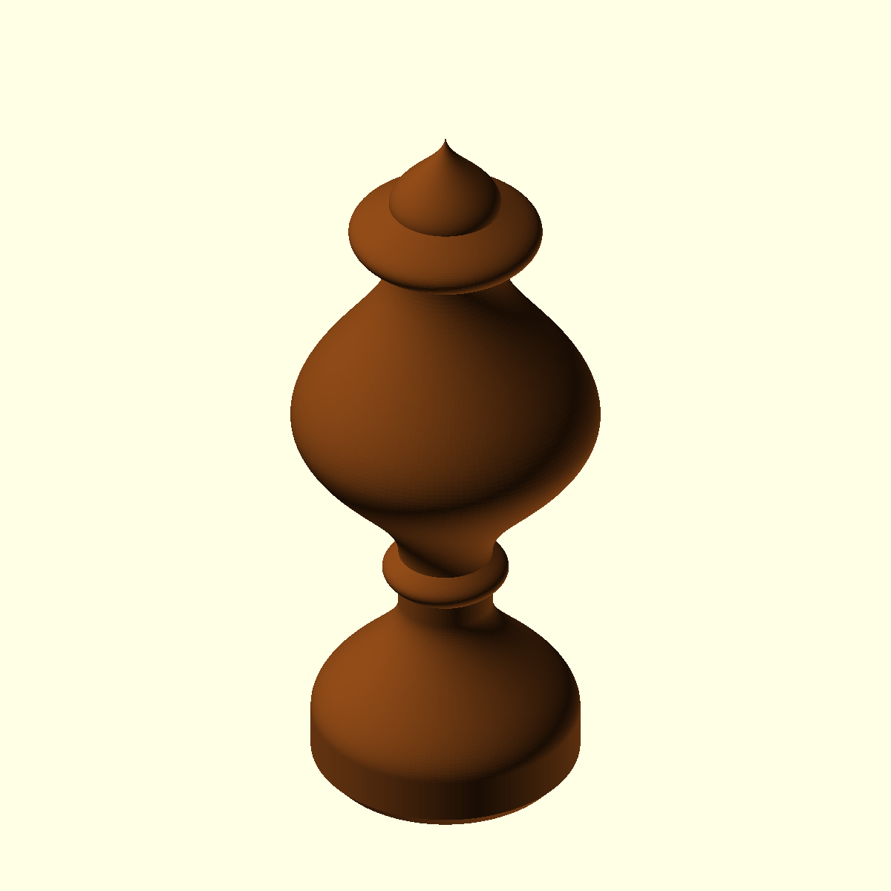
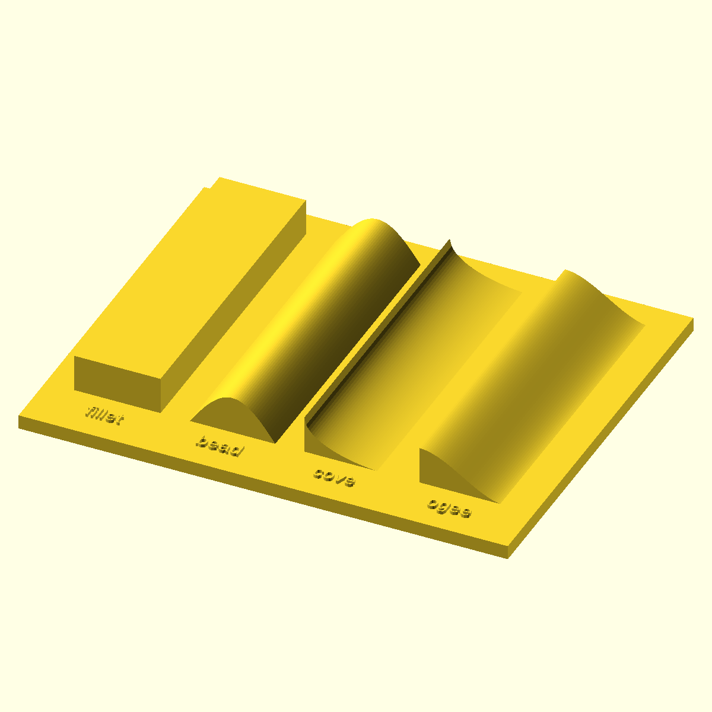

# Architectural Ornament

Parametric, version-controlled architectural components for digital fabrication and traditional casting workflows.

An expanding library of printable study pieces and ornament masters. Dimensions are expressed in millimeters and can be overridden from the OpenSCAD command line. These are design studies, not load-bearing hardware or production-qualified casting patterns.


## Library

| Element | Source | Default dimensions | Vocabulary |
| --- | --- | --- | --- |
| Acorn finial | [acorn.scad](src/finials/acorn.scad) | 120 high, 46 base diameter | Foot, stem, cup, tapering crown |
| Capped urn finial | [urn.scad](src/finials/urn.scad) | 140 high, 50 base diameter, 57.5 maximum diameter | Foot, stem, bead collar, belly, neck, lip, cap |
| Molding sampler | [sampler.scad](src/profiles/sampler.scad) | 102 × 83 backing, 3 thick; 8 relief | Fillet, bead, cove, ogee |





### Profile vocabulary

The sampler reads left to right, with labels at the front:

- **Fillet:** a flat band separating or framing other profiles.
- **Bead:** a rounded, convex ridge.
- **Cove:** a concave hollow.
- **Ogee:** an S-shaped transition combining concave and convex curvature.

These are simplified study profiles, not reproductions of a particular historical molding. The bead uses a sine curve, the cove an elliptical quarter-arc, and the ogee a smooth polynomial. Their normalized functions live in [moldings.scad](src/profiles/moldings.scad); the urn reuses the bead and ogee shapes. The sampler's front ends expose the sections for comparison.

## Requirements

- [OpenSCAD](https://openscad.org/)
- GNU Make

## Render the library

```bash
make
make preview
```

Generated files are written to `build/`:

- `acorn-finial.stl`, `urn-finial.stl`, and `molding-sampler.stl` for slicing
- Matching PNG previews with `make preview`

Build one piece with `make build/urn-finial.stl`. CI exports all three STL files.

Override model parameters without editing the source:

```bash
openscad \
  -D 'finial_height=140' \
  -D 'base_diameter=52' \
  -D 'mounting_hole_diameter=18' \
  -o build/acorn-finial-140mm.stl \
src/finials/acorn.scad
```

For a smaller urn with a blind mounting hole:

```bash
openscad -D 'finial_height=100' -D 'base_diameter=40' \
  -D 'mounting_hole_diameter=10' -o build/urn-small.stl src/finials/urn.scad
```

The urn is solid and capped, not a container. Its optional hole extends 18% of its height from the underside; diameter must be less than 30% of the base diameter. `facets` controls rotational resolution (default 160).

Sampler parameters are `sample_width`, `sample_length`, `relief_height`, `base_thickness`, `gap`, and `labels`. For example, `-D 'labels=false'` omits lettering without changing the profiles.

## Physical evaluation

Print the sampler flat on its backing at 100% scale. Inspect its exposed sections under raking light, and record whether the lettering and thin cove edge survive printing. Print the urn upright; its projecting belly and lip may need supports depending on the printer and material. Check the mounting fit before using it as a master.

Renders and STL exports have been checked digitally; physical prints and mold trials are still pending. Undercuts, mold parting, draft, shrinkage, and release need evaluation before casting. Add photographs and actual print settings alongside the renders once available.

The solid urn's rotational STL export can include zero-area triangles at the axis; the remaining surface passes an edge-closure check. Inspect and repair the mesh in your slicer if it flags these. The tested mounting-hole variant exports as a manifold solid.

## Initial direction

1. Print and evaluate the acorn finial at full scale.
2. Tune proportions, mounting geometry, and minimum wall thickness.
3. Evaluate the urn and molding sampler, then add a spearhead and a simple rosette.
4. Experiment with printed masters and silicone molds.
5. Introduce mesh-based tools when ornament becomes too organic for constructive solid geometry.
